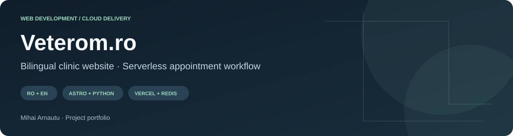
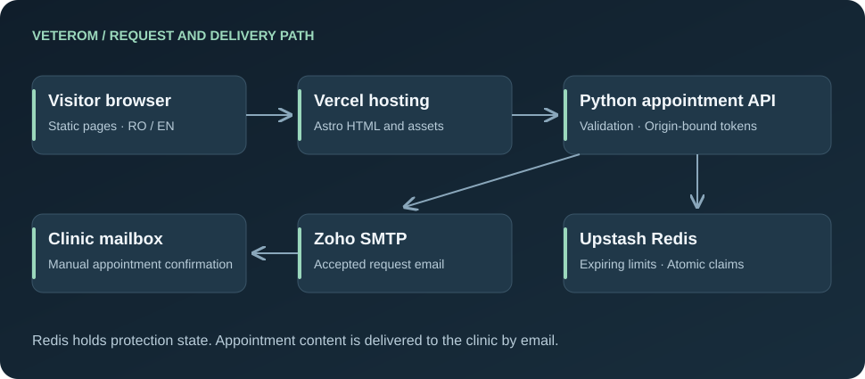
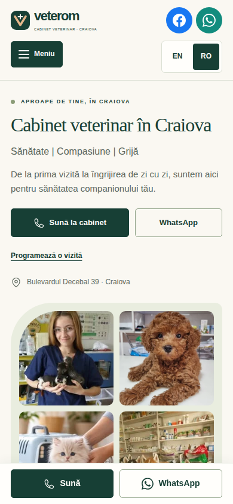
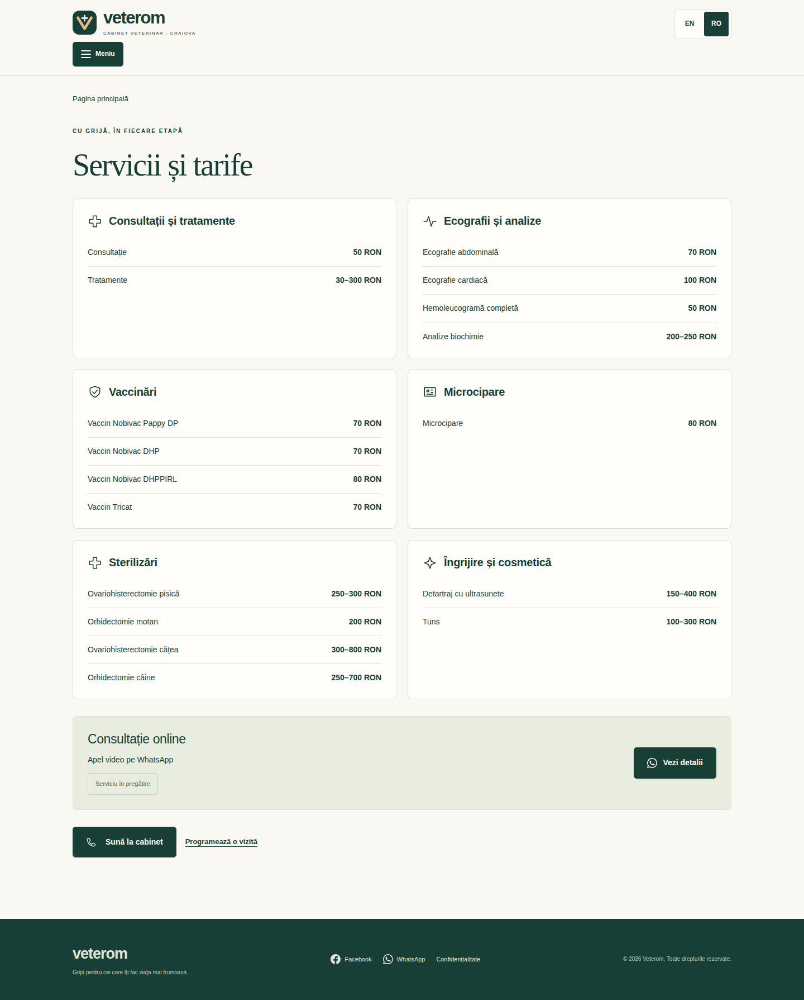
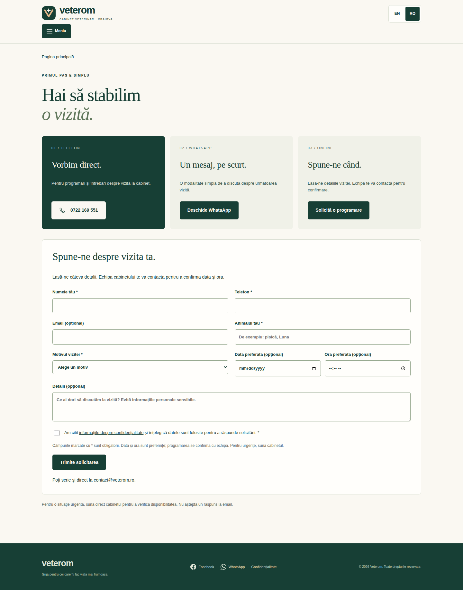
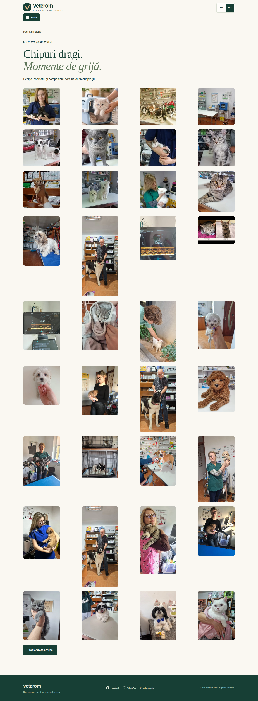

# Veterom.ro — Bilingual Clinic Website and Appointment Workflow

**[Live website](https://www.veterom.ro/) · [English version](https://www.veterom.ro/en/) · [Commit history](https://github.com/mihai-arnautu/veterom/commits/main/) · [Activity](https://github.com/mihai-arnautu/veterom/activity)**

A website for a veterinary clinic in Craiova, Romania, developed from an initial self-hosted deployment into a bilingual cloud-hosted site with appointment requests. The work covers the visitor experience, email workflow, request protection, domain migration and ongoing maintenance.

## At a glance

| Scope | Implemented |
| --- | --- |
| Visitor experience | Romanian and English pages, responsive navigation, phone and WhatsApp actions |
| Clinic content | 36 optimized photographs and 17 cabinet service tariffs |
| Appointment workflow | Validated requests emailed to the clinic for manual confirmation |
| Backend | Python serverless functions with shared Redis request protection |
| Delivery | Private application source, build/test jobs and automatic Vercel deployment |
| Validation | 25 backend tests; a recorded 40-scenario responsive content check |

## The problem and the result

Visitors need practical answers: what the clinic offers, where it is, when it opens and how to contact it. Those answers must remain readable on a small phone and available in either language. The clinic also needs useful request details without implying that a submitted form has reserved an appointment.

The resulting site separates informational pages from a small request API. A visitor can explore the clinic and contact it even when online requests are unavailable. Successful form feedback says the request is awaiting clinic confirmation.

## My role

| Workstream | Contribution |
| --- | --- |
| Interface and content | Built and maintained the Astro pages, shared layout, bilingual copy and mobile contact controls |
| Media and service information | Integrated supplied clinic photographs, optimized assets, gallery metadata and tariff data |
| Appointment system | Implemented validation, localized feedback, privacy acknowledgment and SMTP delivery |
| Serverless adaptation | Replaced process-local protection with stable tokens, shared limits and atomic duplicate claims |
| Deployment | Adapted the Docker-hosted application for Vercel, configured the domain transition and retained a fallback |
| Maintenance | Updated hours and content, added analytics and checked live redirects and availability |

## Architecture

Astro builds static HTML for routine visits. Python handles appointment requests. Redis stores short-lived protection state; Zoho receives the formatted appointment email. The design does not use Redis as an appointment database.

**[Read the architecture and request lifecycle →](docs/architecture.md)**

## Engineering highlights

### Shared protection across serverless workers

The original process-local assumptions were replaced with a stable signing secret and an external store. Tokens can be checked by different function instances, while Redis coordinates request limits and duplicate prevention. Stored identifiers are protected rather than raw visitor details.

### Duplicate prevention when email delivery is uncertain

The handler atomically claims a token before sending. It retains that claim after an ambiguous SMTP error, because a timeout may happen after mail acceptance. The interface gives a clear contact alternative instead of automatically retrying an uncertain send.

### Controlled production activation

Preview and development deployments cannot send real mail. Production requires complete settings, explicit allowed origins and functioning shared protection. Missing settings produce safe diagnostic codes without exposing secrets.

### A working migration path

The cloud adaptation was separated from the original site. Deployment work included fixing Python function detection, supporting Marketplace Redis variable names and correcting custom-domain origins after the DNS transition.

**[Read the decisions, observed failures and fixes →](docs/engineering-decisions.md)**

## Screenshots

Desktop homepage — clinic identity and contact actions

Mobile homepage — narrow-screen layout and contact bar

Services — cabinet tariffs and online consultation summary

Appointment requests — contact alternatives and visitor form

Gallery — optimized clinic photographs

## Technical dossier

| Page | Details |
| --- | --- |
| [Architecture](docs/architecture.md) | Runtime boundaries, request sequence, token lifecycle, limits, data handling and localization |
| [Engineering decisions](docs/engineering-decisions.md) | Nine concrete decisions and fixes, including serverless state and ambiguous email results |
| [Delivery and history](docs/delivery-and-history.md) | CI/deployment workflow, migration sequence and dated source milestones |
| [Validation](docs/validation.md) | Backend coverage, browser evidence, screenshot notes and current limitations |

## Development milestones

| Period | Outcome |
| --- | --- |
| October 2026 | Multipage site, English version, mobile improvements and supplied clinic content |
| October 2026 | Active Zoho appointment delivery, domain setup and expanded photo gallery |
| October 2026 | Vercel migration with shared protection and deployment-specific fixes |
| November 2026 | Revised hours and online consultation content, analytics and redirect maintenance |

The [detailed timeline](docs/delivery-and-history.md#original-application-milestones) records real source revisions. The [commit history of this repository](https://github.com/mihai-arnautu/veterom/commits/main/) records the presentation work from November onward. Explore the [repository activity](https://github.com/mihai-arnautu/veterom/activity) and [commit activity chart](https://github.com/mihai-arnautu/veterom/graphs/commit-activity) for the actual history of this presentation.

## Scope and ownership

The website is live; an appointment is still confirmed by the clinic, not automatically by the form. The online video service remains in preparation and search exclusion is still configured.

This case study contains presentation material, diagrams and screenshots. Private source, deployment secrets and appointment data are maintained separately. Repository visitors have no push permission; changes are maintained by the owner. The architecture credits Astro, Vercel, Upstash, Zoho and Cloudflare for their underlying services.

**Related project:** [AI.Arnautu.uk — Self-Hosted AI Infrastructure](https://github.com/mihai-arnautu/ai-arnautu)
