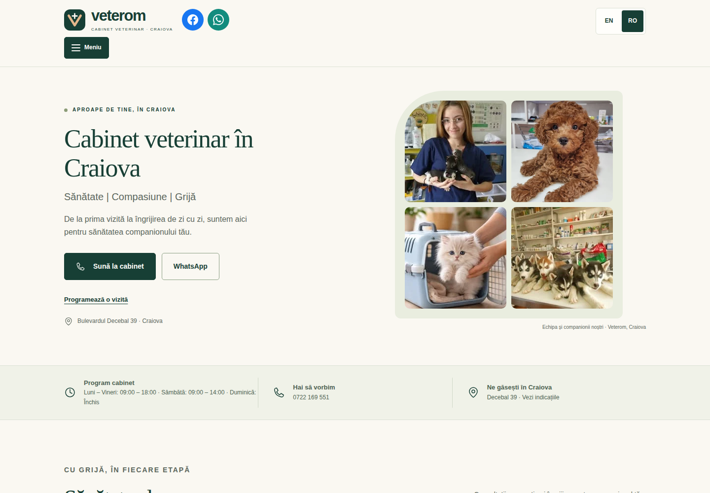
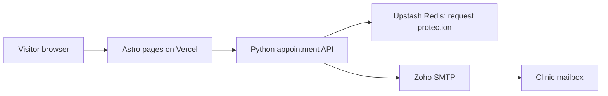

# Veterom.ro

A bilingual website and appointment request system for a veterinary clinic in Craiova, Romania.

**Live website:** [www.veterom.ro](https://www.veterom.ro/) · [English version](https://www.veterom.ro/en/)

## Purpose

Give visitors a clear way to find the clinic, explore its services and photographs, check opening hours and request an appointment from a phone or desktop browser.

## My contribution

- Built and maintained the responsive Astro website and its Romanian/English content.
- Implemented shared page components, language switching and mobile contact controls.
- Added a gallery with 36 optimized photographs and published 17 cabinet service tariffs.
- Integrated appointment requests with a Python backend and Zoho SMTP delivery.
- Adapted the original Docker deployment for Vercel, using Upstash Redis for shared request protection.
- Configured the custom domain and maintained content, deployment and analytics integration.

## Main features

- Romanian and English versions, including navigation, forms and page metadata.
- Services, clinic information, gallery, contact details and reviews links.
- Mobile phone and WhatsApp contact actions.
- Appointment requests with validation and localized feedback.
- Vercel Web Analytics, with an updated privacy notice.

An appointment request requires confirmation by the clinic; it does not reserve a time slot automatically. The online video consultation section remains labelled as a service in preparation.

## Architecture

| Layer | Implementation |
| --- | --- |
| Website | Astro, TypeScript, HTML and CSS |
| API | Python serverless functions |
| Request protection | Expiring origin-bound tokens, shared limits and duplicate prevention |
| Shared state | Upstash Redis REST API |
| Email | Zoho SMTP |
| Hosting | Vercel with custom domain |
| DNS | Cloudflare |
| Earlier deployment | Docker, Nginx and Python backend |

## Implementation decisions

**Shared protection for serverless requests.** Redis holds temporary counters and protected identifiers so rate limits and duplicate prevention work across function instances. Appointment content is not stored in Redis.

**Email acceptance before success.** The backend waits for SMTP acceptance before returning success. Successful delivery was tested and receipt confirmed during implementation; mailbox arrival is distinct from SMTP acceptance.

**One content structure for both languages.** Shared components and translation data keep page structure consistent while allowing localized content and page-preserving language switching.

**A separate cloud adaptation.** The Vercel repository was developed separately from the original self-hosted deployment, preserving a fallback during migration.

## Validation and operation

- Production build and checks of generated pages.
- Browser checks in both languages at mobile, tablet and desktop widths.
- Appointment backend tests and authorized delivery checks during implementation.
- Latest content update checked across 40 browser scenarios at 320, 390, 768 and 1440 pixels.
- Live checks of updated hours, consultation content, analytics script delivery and retired page redirects.

## Project status

The public website runs on Vercel. The original self-hosted source and fallback deployment are maintained separately. This repository presents the project; it does not contain private application code, credentials or appointment data.

Built with [Astro](https://astro.build/), [Vercel](https://vercel.com/), [Upstash](https://upstash.com/), [Zoho Mail](https://www.zoho.com/mail/) and [Cloudflare](https://www.cloudflare.com/).
