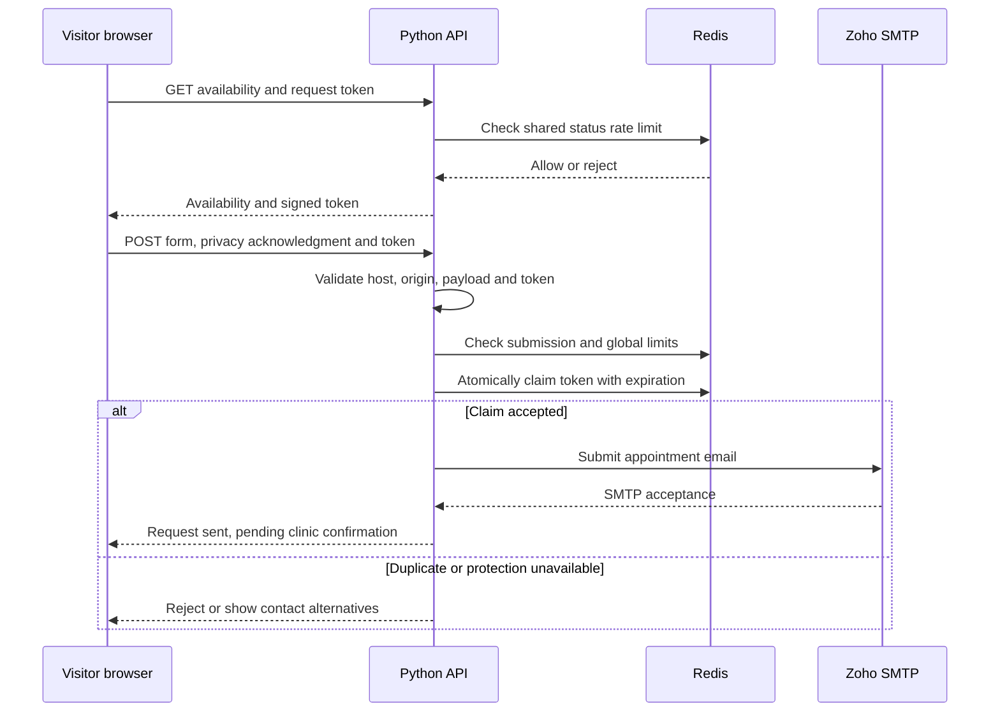

# Architecture and request lifecycle

[← Project overview](../README.md) · [Engineering decisions](engineering-decisions.md) · [Validation](validation.md)

## Two workloads, two execution models

The site serves mostly informational content: clinic details, tariffs, photographs and contact links. Astro builds those pages as static HTML. A small Python API handles the one workflow that requires server-side execution: submitting an appointment request to the clinic.

This keeps routine page visits independent of SMTP and Redis availability. If the appointment backend is unavailable, visitors can still read the site and use the telephone or email alternatives.

| Responsibility | Runtime | State |
| --- | --- | --- |
| Page rendering | Astro build on Node 24 | Content and translations in project files |
| Page delivery | Vercel static hosting | Generated HTML, CSS, scripts and optimized photographs |
| Appointment validation | Python 3.12 function | Request-local values |
| Request protection | Upstash Redis over HTTPS | Expiring counters and protected identifiers |
| Appointment delivery | Zoho SMTP | Messages retained in the clinic mailbox |
| Visitor statistics | Vercel Web Analytics | Analytics handled by the provider |

## A request from browser to clinic



## Why the status endpoint exists

The form asks the API whether requests are available before enabling submission. This handles missing configuration, disabled booking and unavailable request protection without presenting a working-looking form that cannot send.

The same response provides an expiring token. A stable environment secret signs tokens with HMAC-SHA256, allowing separate function instances to validate them. Tokens are bound to the allowed origin, have a minimum age of two seconds and expire after 30 minutes.

The minimum age and hidden form field are lightweight abuse signals; the shared limits and atomic claim provide additional controls. None is presented as a substitute for every possible anti-abuse measure.

## Shared limits and duplicate prevention

| Control | Configured limit or behavior |
| --- | --- |
| Availability checks | 60 per client per minute |
| Submission attempts | 5 per client per minute |
| Valid submission attempts globally | 100 per 30 minutes |
| Request size | Maximum 12,000 bytes |
| Token lifetime | 30 minutes |
| Token claim | Atomic Redis `SET` with `NX` and expiry |

Client identifiers are protected with keyed hashing before being used in Redis keys. Raw form content and raw tokens are not stored there. The platform forwarding header is trusted only when the handler is running on Vercel; local execution uses the socket address.

## Data boundaries

| Data | Handling |
| --- | --- |
| Name, phone, animal and reason for visit | Validated, then formatted into the clinic email |
| Optional email, preferred date/time and message | Validated when present |
| Privacy acknowledgment | Required before accepting the request |
| Appointment content | Not written to Redis or application request logs |
| Rate counters and protected identifiers | Stored temporarily with expiry |
| Received appointment email | Kept in the clinic mailbox under its retention practices |

The design avoids a separate appointment-content database. It does not eliminate personal data processing: the clinic still receives and retains email.

## Site structure and localization

The source separates shared layout, reusable components, page content and data:

```text
src/
  layouts/Layout.astro          Shared header, footer and analytics
  components/AppointmentForm   Localized request interface
  pages/                       Romanian page components
  pages/en/[...page].astro      English routes reusing shared pages
  i18n/                        Translation helpers and English strings
  data/                        Clinic details, tariffs and gallery metadata
api/                           Vercel function entrypoints
booking/                       Validation, SMTP and serverless protection
```

English pages retain the Romanian slugs beneath `/en/`. Switching language preserves the page. Clinic hours, contact details and tariffs are maintained in shared data rather than repeated across pages.

## Hosting and external dependencies

Vercel delivers the static output and runs the Python functions in the configured Frankfurt region. Cloudflare provides DNS. The apex domain redirects to the `www` hostname. Zoho handles mail and Upstash provides the shared Redis REST interface.

The website uses explicit security and no-store headers. Search exclusion remains configured; publishing a working custom domain did not automatically authorize search indexing.

Source code and deployment secrets remain in the private application workflow. This case study exposes the design, not the live configuration values.
