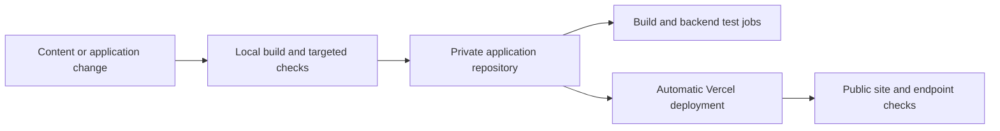

# Delivery, migration and development history

[← Project overview](../README.md) · [Engineering decisions](engineering-decisions.md) · [Validation](validation.md)

## Delivery workflow

The private application repository contains a Node 24 static build job and a Python 3.12 unit-test job. The Vercel integration automatically deploys changes pushed to the application repository. The presence of a CI configuration is distinct from checking every remote pipeline result.

Portfolio commits are separate: they update this documentation repository and do not deploy the clinic website.

## Migration sequence

1. Preserve the running Docker site and its configuration.
2. Create the independent serverless adaptation with shared request protection.
3. Validate the static output and mocked backend behavior locally.
4. Deploy to the temporary Vercel hostname.
5. Configure production Redis, mail and origin settings.
6. Perform an authorized synthetic email test and confirm receipt.
7. Connect the clinic domain and check redirects, HTTPS and API availability.
8. Correct origin configuration and keep the fallback until separately retired.

## Original application milestones

These dates and short commit IDs come from the private application history. They describe real project work; they are not backdated commits in this presentation repository.

| Date | Source revision | Milestone |
| --- | --- | --- |
| 9 Oct 2026 | `21e44a8` | Multipage navigation, clinic photos and initial demo appointment workflow |
| 9 Oct 2026 | `656de84` | English translations, page-preserving language switch and reviews page |
| 9 Oct 2026 | `6a21114` | Responsive homepage and mobile contact improvements |
| 9 Oct 2026 | `eacc60a` | Publication of the supplied cabinet service tariffs |
| 17 Oct 2026 | `ff4105a` | Updated photographs, custom domain and active Zoho appointment delivery |
| 17 Oct 2026 | `7d1bbbb` | Independent Vercel adaptation with shared booking protection |
| 17 Oct 2026 | `c0445a8` | Explicit Python entrypoints for function detection |
| 17 Oct 2026 | `a123f98` | Support for Vercel Marketplace Redis variable names |
| 17 Oct 2026 | `fad9284` | Safe booking configuration diagnostics |
| 2 Nov 2026 | `3256fe8` | Updated clinic hours, revised online consultation content and analytics |
| 2 Nov 2026 | `d418a62` | Redirect correction for retired URLs with trailing slashes |

## Routine content maintenance

| Change | Relevant source area | Check |
| --- | --- | --- |
| Clinic hours/contact | Shared clinic data and translated hours | Homepage and Contact in both languages |
| Service tariff | Tariff data and translations | All rows, long labels and small-screen alignment |
| Photograph | Optimized image asset and gallery metadata | Decode, dimensions, alt text and loading |
| Shared navigation | Layout and translation strings | Keyboard, mobile menu and locale preservation |
| Form behavior | Shared component and Python handlers | Localized feedback, validation and backend tests |
| Hosting origin | Production settings and site URL | Both hostnames and API status |

## Deployment checks and rollback considerations

Check the new deployment on the live domain, rather than assuming that a local build proves production configuration. Static pages, Redis credentials, SMTP access and allowed origins are separate dependencies.

During migration, the original source and runtime were preserved. Restoring an earlier application revision and changing hosting/DNS are different operations; a source revert alone does not migrate traffic. The case study records the fallback strategy without distributing its private configuration.

## Repository activity

- [Presentation commit history](https://github.com/mihai-arnautu/veterom/commits/main/)
- [Repository activity](https://github.com/mihai-arnautu/veterom/activity)

The portfolio repository was created in November 2026. Its activity reflects changes to the case study; the table above records the earlier application history. The [commit activity chart](https://github.com/mihai-arnautu/veterom/graphs/commit-activity) provides GitHub's view of those presentation commits.
